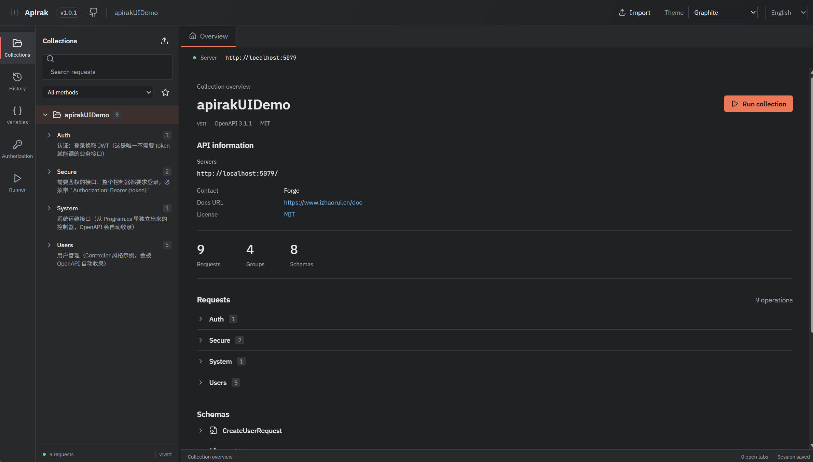
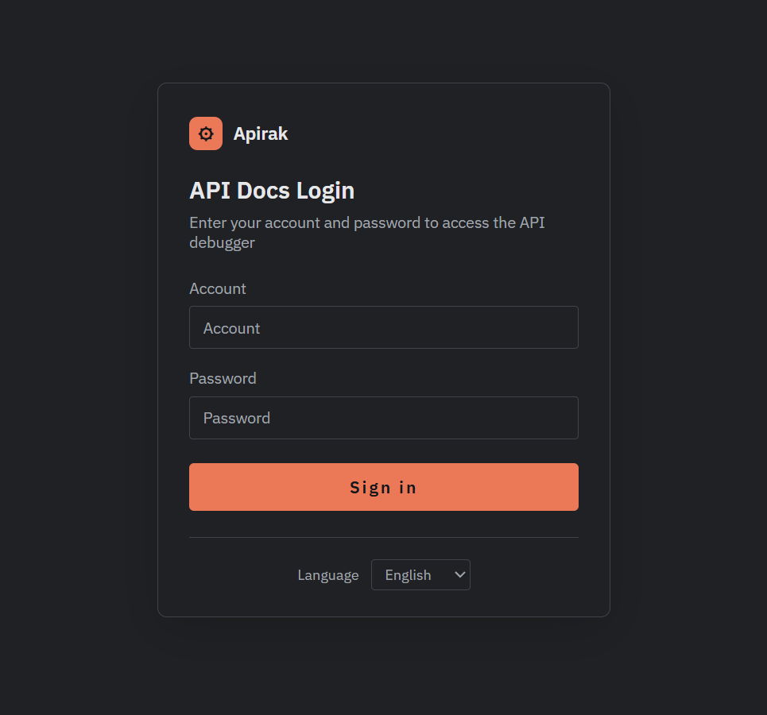

# Apirak

> 中文文档：[README.zh-CN.md](README.zh-CN.md)

**Apirak** is an OpenAPI debugging workbench built on **Vue 3 + Vite + TypeScript**. After importing an OpenAPI 3.x / Swagger 2.0 spec, you can browse endpoints, edit requests, manage collections and variables, run them in batches, and generate multi-language request code and client SDKs — just like Postman. When deployed standalone, all workspace data is persisted locally with no login and no backend dependency required. Optional backend-backed **login / access control** can also be enabled (see [Login Page & Access Control](#login-page--access-control)).

It supports two usage modes, both first-class in this repo:

| Mode | Artifact | Who serves the page |
| --- | --- | --- |
| **Standalone** | `npm run build:prod` → `dist/` | Any static server / CDN / Nginx |
| **Embedded in .NET** | `npm run build:dotnet` → `dist/` | An ASP.NET Core class library embeds `dist/` as resources, served by middleware |

The only difference is the build mode (`--mode dotnet` rewrites asset references to relative paths and points the default spec address to `/openapi/v1.json`); the source code is identical.

<p align="center">
  
</p>

---

## Table of Contents

- [Features](#features)
- [Interface Preview](#interface-preview)
- [Tech Stack](#tech-stack)
- [Requirements](#requirements)
- [Quick Start](#quick-start)
- [Spec Source Resolution Rules](#spec-source-resolution-rules)
- [URL Parameters](#url-parameters)
- [Environment Variables](#environment-variables)
- [Run Modes](#run-modes)
- [Scripts](#scripts)
- [Login Page & Access Control](#login-page--access-control)
- [Integrate into ASP.NET Core](#integrate-into-aspnet-core)
- [Build Artifacts](#build-artifacts)
- [Project Structure](#project-structure)
- [Testing](#testing)
- [FAQ](#faq)
- [License](#license)

---

## Features

### Spec Import & Parsing

- Supports **OpenAPI 3.x** and **Swagger 2.0** documents, both JSON and YAML.
- Import specs from a **URL** or a **local file** (`ImportSpec`), or inline a `data:` document directly.
- Full recursive `$ref` resolution (including `~0` / `~1` escaping), with automatic merging of Path Item and Operation-level parameters.
- Clear troubleshooting hints when an HTML page is received instead of a spec document (usually a `VITE_API_BASE_URL` / `VITE_SPEC_PATH` misconfiguration).
- When importing from a **URL** fails, targeted hints are given by cause: wrong path / document name (404), auth issues (401 / 403), server errors (5xx), or network / cross-origin anomalies (CORS / Failed to fetch — possible causes are listed neutrally when the browser hides the real reason). On same-origin setups with `VITE_API_BASE_URL` configured, it automatically retries once via `/api-proxy`.

### Request Debugging

- Multi-tab (Tabs) workspace; tabs can be closed and persisted, with a right-click menu for batch operations.
- Visual key-value editing (`KeyValueEditor`) for parameters / headers / forms, with enable toggles and file-upload markers.
- Request body supports multiple `contentType` values such as JSON / form, with a built-in **Monaco Editor** for editing and highlighting.
- Response shows status code, duration, body size and response headers; binary responses are handled as Blob and downloadable.
- Favorites, filtering by HTTP method, and request search.

### Authorization

- Automatically recognizes `securitySchemes` in the spec, supporting:
  - **Basic Auth** (username / password)
  - **API Key** (header / query / cookie)
  - **Bearer Token**
  - **OAuth 2.0**: the `implicit`, `password`, `client_credentials`, and `authorization_code` flows, with Client Secret and Scope configuration, automatically exchanging for and caching an Access Token (with expiry).
- Credentials are stored isolated per spec and can be enabled / disabled with one click.
- **The "Remember credentials" switch controls whether credentials are persisted**: when checked, credentials are written to `localStorage` under `<workspace-id>:credentials` and auto-filled on page reload; when unchecked they live only for the current session and are cleared on reload (unchecked by default; credentials are stored in plaintext, enable as needed).
- **Credential values support variables**: access tokens / usernames / passwords / API keys can all be filled with `{{variableName}}` and are only substituted at send time.
  A typical pattern is to have a login request store `token` as an output variable, then fill the auth panel with `{{@token}}` so subsequent requests carry it automatically.
  OAuth client secret and resource-owner password support this too.
  When a variable is undefined the literal is kept (no silent empty value is sent), and the input box colors unresolved references.

### Collections & Runner

- Save any request into a **Collection**; collections can be imported / exported (**import / export include the shared config groups and request parameters by default**), and an inter-request delay can be set.
- **Collection Runner**: executes the whole collection sequentially in batch and summarizes the results — great for regression / smoke testing.
- **Shared collection config groups**: configure multiple groups of shared "request headers / request parameters" on a collection. Each group can be named independently, collapsed / expanded, and you check which requests it applies to (**a request can belong to multiple groups** — group configs are merged/overlaid, with the request's own draft taking priority). The group's headers / parameters also support `{{variables}}` and output variables (e.g. `{{@token}}`) — a typical use is to have a login request extract a token, then use a config group to inject `Authorization: Bearer {{token}}` into all downstream requests uniformly. Collection names and config group names must be unique.
- **Friendly import validation**: when importing a collection file, if the file is corrupt, missing fields, contains requests not present in the current spec, or the collection name duplicates an existing one, a clear, multilingual error is shown (instead of a vague message).
- **Run history** is kept automatically (capped at 100 entries); **each entry can be expanded to show the request URL, request headers, request body, response headers, and response body**, and supports **deleting a single entry** as well as clearing all at once. Before being persisted, sensitive request headers (authorization / cookie / token, etc.) in the history are redacted.

### Variable System

- A workspace-level **variable table**; request parameters, headers, and bodies can reference variables via placeholders.
- **Outputs** after a request executes can be written back as variables for use by subsequent requests in a chain (e.g. log in first to fetch a token).

### Code Generation

- Entry point is the "**Code**" tab of a specific endpoint (alongside Parameters / Headers / Body); switching endpoints switches the generation target.
- One-click generation of single-request snippets: **cURL**, **JS/TS (Fetch)**, **Python (requests)**, **C# (HttpClient)**, **Java (OkHttp)**.
- Built-in client SDK generators:
  - **C# API Client** (`csharpApiClientGenerator`)
  - **JavaScript API Client** (`javascriptApiClientGenerator`)

### Misc

- **Overview**: Markdown document rendering (`marked` + `DOMPurify` sanitization, XSS-safe).
- **i18n**: ships **English / 简体中文 / 繁體中文** locale bundles.
    - **Default language is negotiated by the browser**: when not manually set, `navigator.languages` selects the default (Chinese browser → Chinese, English browser → English); if the browser language is none of the three (e.g. `fr`/`de`/`ja`) it falls back to **English**.
    - **Manual selection wins and persists**: switching language at the bottom of the home or login page writes `localStorage['apirak:locale']` and takes effect immediately; thereafter reloads and revisits honor that choice instead of the browser.
    - The login page and home page share the same i18n instance and storage key, so language is **kept in sync both ways**.
- **Themes**: several built-in presets — default dark `graphite`, plus dark themes `github-dark` / `visual-studio-dark` / `dark-plus` / `dark-modern` / `contrast`, light themes `github-light` / `visual-studio-light`, and a `system` option that follows the OS color scheme. The login page and home page share theme variables for consistent styling.
- **Workspace persistence**: Tabs, history, favorites, variables, and collections are stored in `localStorage` keyed by spec identity (URL or `info.title + version`), with version validation and structural sanity checks; corrupt data auto-rolls back.
  Auth credentials are not included here — they are controlled separately by the "Remember credentials" switch (see above).
- **Dev proxy**: a built-in `/api-proxy` forward to bypass browser cross-origin restrictions.
- **JSONPath** query support for locating data in responses.

---

## Interface Preview

**Main workspace (endpoint browsing, request debugging, and collections / variables / runner / code generation):**



**Login page (`/login`, optional feature; whether it is enabled is decided by the backend):**



---

## Tech Stack

| Category | Technology |
| --- | --- |
| Framework | Vue 3.5 (Composition API) + TypeScript 5.7 |
| Build | Vite 6 + vue-tsc |
| State Management | Pinia 2 |
| Internationalization | vue-i18n 10 |
| Editor | Monaco Editor (@guolao/vue-monaco-editor) |
| Utilities | @vueuse/core, js-yaml, jsonpath-plus, marked, DOMPurify, lucide-vue-next |
| Testing | Vitest 4 + @vue/test-utils + jsdom |
| Linting | ESLint 9 + eslint-plugin-vue + @typescript-eslint |

---

## Requirements

- **Node.js ≥ 22.12.0** (declared in the `engines` field)
- npm (ships with Node)
- Only the "embed in .NET" path additionally needs: .NET 10 SDK (consumed by the class library side that uses `dist/`)

---

## Quick Start

### Standalone

```bash
# 1. Install dependencies
npm install

# 2. Copy the environment variable template and edit as needed
cp .env.example .env

# 3. Start the dev server (defaults to http://127.0.0.1:5173)
npm run dev
```

Build the production version:

```bash
npm run build:prod
# Artifacts are output to dist/
npm run preview   # Preview the build locally
```

> `public/swagger.json` is a sample spec shipped with the repo; use it to try all features when no remote API is configured.

### Embed in .NET (serve as a `/docs` page for ASP.NET Core)

```bash
npm run build:dotnet
```

The artifacts also land in `dist/`, after which the .NET-side class library embeds the entire directory into the dll.
On the frontend side you **only need to run this one command**; see [Integrate into ASP.NET Core](#integrate-into-aspnet-core) for how to wire it up.

---

## Spec Source Resolution Rules

At startup the app decides which OpenAPI document to load, by priority from high to low (`src/main.ts`):

| Priority | Source | Notes |
| --- | --- | --- |
| 1 | URL param `?spec=` / `?url=` | Most convenient for ad-hoc debugging; writes no config |
| 2 | `spec` injected by host via `#docui-config` | JSON injected by the .NET middleware into `index.html` |
| 3 | Build-time `define` of `__SPEC_URL__` | Assembled from `.env.<mode>`'s `VITE_API_BASE_URL` + `VITE_SPEC_PATH` |
| 4 | Same-directory `swagger.json` | Fallback — the copy of `public/swagger.json` placed into `dist/` |

The spec **display name** follows the same logic: `?name=` > host-injected `name` > build-time `__SPEC_NAME__` > empty
(when empty, the UI uses `info.title` from the document directly).

The benefit of this design: once embedded in .NET, changing the mount prefix or the document address is a **runtime** concern — no frontend rebuild needed.

---

## URL Parameters

| Param | Effect | Example |
| --- | --- | --- |
| `spec` / `url` | Specifies the spec address to load, overriding all config | `/docs/?spec=https://petstore3.swagger.io/api/v3/openapi.json` |
| `name` | Specifies the spec display name | `/docs/?name=Petstore` |

Handy for debugging cross-origin documents — no env changes, no rebuild; just add the param to the address bar.

---

## Environment Variables

All configuration is injected via `.env` files (or `.env.<mode>` overrides); see `.env.example` for the template:

| Variable | Description | Example |
| --- | --- | --- |
| `VITE_API_BASE_URL` | Backend API address. When **non-empty**, the dev server enables the `/api-proxy` proxy to this address to avoid cross-origin issues | `http://localhost:8011/` |
| `VITE_SPEC_PATH` | OpenAPI spec path (relative to the API address), defaults to `/v3/api-docs` (Spring Boot's default doc path) | `/openapi/v1.json` |
| `VITE_SPEC_NAME` | Spec display name. **Recommended left empty** to use the document's `info.title` directly; only used as a fallback when the document lacks `info.title` | (empty) |

Typical configuration:

```dotenv
# Spring Boot project
VITE_API_BASE_URL=http://localhost:8011/
VITE_SPEC_PATH=/v3/api-docs
VITE_SPEC_NAME=
```

```dotenv
# ASP.NET Core project (.env.dotnet)
VITE_API_BASE_URL=
VITE_SPEC_PATH=/openapi/v1.json
VITE_SPEC_NAME=
```

- When `VITE_API_BASE_URL` is not configured, the app fetches the spec directly from `VITE_SPEC_PATH` (that path must allow cross-origin, or use a static file under `public/`). Embedded in .NET, the page and API are same-origin — exactly this case.
- At runtime you can also import a spec from a **local file** or **pasted content** in the page, with no pre-configuration needed.

---

## Run Modes

The project ships several Vite modes, each mapping to a different `.env.<mode>` file:

| Script | Mode | Purpose |
| --- | --- | --- |
| `npm run dev` / `dev:test` / `dev:prod` / `dev:local` | development / test / production / local | Local development, loads the corresponding env config |
| `npm run build` / `build:test` / `build:prod` | same as above | Build the artifact for the corresponding env |
| `npm run build:dotnet` | dotnet | Build the artifact for embedding into a .NET class library (relative paths + `/openapi/v1.json`) |

The `dotnet` mode does not disturb any of the other modes: `.env.dotnet` is a new file, and dev/test/prod behavior is unchanged.

---

## Scripts

| Command | Description |
| --- | --- |
| `npm run dev` | Start the dev server (127.0.0.1:5173) |
| `npm run build` | Type check + production build (`vue-tsc --noEmit && vite build`) |
| `npm run build:test` / `build:prod` | Build the artifact for the corresponding env |
| `npm run build:dotnet` | Build the artifact for .NET embedding (**deletes `dist/` before building**) |
| `npm run preview` | Preview the build |
| `npm run test` | Run unit tests (Vitest, single run) |
| `npm run test:watch` | Run tests in watch mode |
| `npm run typecheck` | Type check only |
| `npm run lint` | ESLint check with auto-fix |

> The `(if exist dist rmdir /s /q dist)` line in `build:dotnet` is not redundant: in some environments (e.g. restricted CI toolchains) Vite's `outDir` cleanup goes through a "move to trash" implementation that gets blocked, raising an `Error during a 'trash' operation`. Using cmd's native `rmdir` sidesteps it; remove that line and the second build fails.

---

## Login Page & Access Control

Login is an **optional feature**: whether login is required, who validates it, and where to redirect after login are all decided by the backend. The frontend only provides the login page UI and the agreed form fields and redirect parameters.

### How it works (frontend side)

- **No router is introduced**. The SPA branches by path: when `location.pathname` (trailing slash removed) ends with `/login`, the login view is rendered; all other paths (including `/`) render the workbench home.
    - Dev: `http://127.0.0.1:5173/login`
    - Embedded in .NET (mounted under `/docs`): `http://<host>/docs/login`
- The login page **reuses the home page's theme and i18n**: styles consume `main.css` theme variables, and the bottom language dropdown shares the same `i18n` instance and `localStorage['apirak:locale']` with the home page, keeping language in sync both ways.
- Form behavior (conventions for backend integration):
    - `method="post" action=""`: POSTs back to the **current path** (e.g. `/login`, `/docs/login`), with no hardcoded endpoint.
    - Hidden field `return`: carries the login source (the original target path injected by the backend when an unauthenticated user was redirected), used to return after a successful login.
    - Reads URL `?error`: when backend validation fails it redirects back to the login page with `?error=1`, and the frontend shows an error accordingly.
    - Reads URL `?return`: when an unauthenticated user accesses a protected resource, the backend redirects to the login page with `?return=<original path>`.

### What the backend needs to do

The frontend only renders the page; the account system, validation, and cookies are implemented by the host (e.g. the .NET-side `DocUiMiddleware`). To make the login page actually usable, the host must satisfy three conventions:

1. **The login path returns the SPA's `index.html`**: when `/login` (or `/docs/login`) is accessed, the host must return the SPA entry (`dist/index.html`) as the response rather than a 404, so the frontend can take over and render the login view. (In dev mode Vite's history fallback handles this — just visit `/login`.)
2. **That path accepts POST and validates**: provide an endpoint consuming the form fields `username` / `password` / `return` —
    - validation passes → issue an auth Cookie, 302 redirect to `return` (or home if absent);
    - validation fails → 302 redirect back to the login page with `?error=1`.
3. **Unauthenticated access to protected resources redirects to the login page**: redirect to the login page with `?return=<original path>` when an unauthenticated user hits a protected resource.

> The frontend form field names (`username`/`password`/`return`) and the `?error`/`?return` conventions already align with common `DocUiMiddleware` implementations (its `HandleLoginPost` / `IsLoginArea`), so the backend can integrate without extra adaptation.

### Disabling login

When no account/password is configured (the host does not enable auth), the frontend's `isLoginRoute` branching still works, but **no one redirects you to the login page** — `/` opens the workbench home directly, i.e. "login is optional".

---

## Integrate into ASP.NET Core

The page can be embedded as a whole directory into a dll by a .NET class library, and the host app mounts it at `/docs` with two lines of code. There are three conventions along this chain — any change on either side must stay aligned:

### 1. Artifacts reference assets via relative paths

`vite.config.ts`:

```ts
base: command === 'build' ? './' : '/',
```

The produced `index.html` references `./assets/index-xxx.js` instead of `/assets/index-xxx.js`.
**This point is the most critical** — absolute paths bypass the mount prefix and hit the site root directly; the page opens but every js/css 404s.
Dev mode still uses `/` to keep history fallback working.

### 2. Use `.env.dotnet` to specify the document address

```
VITE_API_BASE_URL=
VITE_SPEC_PATH=/openapi/v1.json
VITE_SPEC_NAME=
```

With `VITE_API_BASE_URL` left empty, the `__SPEC_URL__` baked into the artifact is `/openapi/v1.json`,
matching ASP.NET Core's built-in `MapOpenApi()` default path — same-origin, no proxy needed.

### 3. Runtime configuration injected by the host

The host (.NET middleware) does two things when serving `index.html`:

1. Replace `<title>` with the configured title;
2. Insert a JSON snippet before `</head>`:

```html
<script id="docui-config" type="application/json">
  {"root":"/docs","spec":"/openapi/v1.json","title":"Demo.Api 接口文档"}
</script>
```

`src/main.ts`'s `readHostConfig()` reads this node and takes `spec` (optionally `name`) as the spec address.
When the node is absent it returns an empty object and falls back to the build-time `__SPEC_URL__` — **standalone deployment behavior is completely unaffected**.

```ts
function readHostConfig(): { spec?: string; name?: string } {
  try {
    const el = document.getElementById('docui-config')
    return el?.textContent ? JSON.parse(el.textContent) : {}
  } catch {
    return {}
  }
}
```

### Why not write a `{{title}}` placeholder in `index.html`

Because `dist/index.html` is a **build artifact** — the next `npm run build` wipes any hand-written content.
Likewise, do not edit any file under `dist/` by hand — change the source or template, then rebuild.

### How the host changes the mount prefix

The consumer writes the prefix directly on the mount line; change and restart:

```csharp
app.OpenApiUI("docs");        // -> /docs
app.OpenApiUI("api-docs");    // -> /api-docs, no frontend rebuild needed
```

Because `base: './'` makes all references in the artifact relative, the page works under any mount prefix —
**this is exactly why convention #1 exists**.

### Frontend change checklist

After changing the frontend, the consumer only needs the new artifact:

```bash
npm run build:dotnet     # 1. produce the artifact
# 2. on the .NET side run dotnet build (or dotnet build /p:BuildVue=true in one step)
```

Hash changes in `dist/` filenames don't matter — the consumer uses wildcards and changes no config.

---

## Build Artifacts

After `npm run build:dotnet`, `dist/` roughly looks like:

```
dist/
├── index.html                 # Entry; asset references are ./assets/... relative paths
├── apirak.png             # From public/, page icon
├── swagger.json               # From public/, sample spec, fallback source (priority 4)
└── assets/
    ├── index-<hash>.js
    └── index-<hash>.css
```

- Files under `public/` are copied **as-is** to the `dist/` root, without hashing, so they can be referenced by stable URLs.
- Filenames under `assets/` carry a content hash and change on every code change — consumers must use wildcards, never hardcode filenames.
- `swagger.json` is used for "import sample API"; if your scenario doesn't need it, just delete `public/swagger.json`,
  but then priority-4 fallback is gone too.

---

## Project Structure

```
apirak/
├── public/                  # Static assets (app icon, sample swagger.json)
├── src/
│   ├── components/
│   │   ├── Authorization.vue    # Auth panel (Basic / API Key / Bearer / OAuth2)
│   │   ├── ImportSpec.vue       # Spec import (URL / file / paste)
│   │   ├── RequestView.vue      # Request editing & response display
│   │   ├── RequestTabContextMenu.vue  # Tab right-click menu
│   │   ├── Runner.vue           # Collection runner
│   │   ├── Workspace.vue        # Workspace main layout (tabs / nav / theme / language)
│   │   ├── LoginView.vue        # Login page (/login path branch; optional login, backend-auth)
│   │   ├── tools/               # Tool panel (collections / history / overview / variables)
│   │   └── ui/                  # Shared UI components (Monaco wrapper, key-value editor, Modal, etc.)
│   ├── composables/             # Composables (useWorkspace)
│   ├── i18n/                    # Internationalization (en / zh-CN / zh-TW)
│   ├── lib/
│   │   ├── api.ts               # Spec parsing, $ref expansion, Operation extraction
│   │   ├── codeSnippets.ts      # cURL / Fetch / Python / C# / Java snippet generation
│   │   ├── generators/          # C# and JavaScript client SDK generators
│   │   ├── oauth.ts             # OAuth2 token acquisition & refresh for each flow
│   │   └── workspace.ts         # Workspace persistence (version check / data validity check)
│   ├── styles/                  # Global styles
│   ├── types.ts                 # Core type definitions
│   └── main.ts                  # Entry: source priority resolution, host config reading
├── .env.example             # Environment variable template
├── .env.dotnet              # Build config for .NET embedding (relative base + /openapi/v1.json)
├── vite.config.ts           # Vite config (alias @, /api-proxy proxy, base, spec URL injection)
└── package.json
```

---

## Testing

Tests are based on Vitest + jsdom, covering core logic such as spec parsing and workspace persistence:

```bash
npm run test          # single run
npm run test:watch    # watch mode
```

After changing parsing or persistence logic under `src/lib/`, run the tests before producing artifacts.

---

## FAQ

**The page opens but is blank, with a bunch of 404s in the console**
The artifact's asset references are absolute paths (`/assets/...`). Confirm it was built with `build:dotnet`,
and that `vite.config.ts`'s `base` is `'./'` when `command === 'build'`.

**The page says "received HTML instead of a spec document"**
The `spec` address pointed at an HTML page (usually a SPA's index.html, or the address got eaten by a mount prefix).
Verify by adding `?spec=/openapi/v1.json` to the `/docs/` address bar; once confirmed, check the host's `OpenApiUrl` config.

**Changed the title / document address on the .NET side but the page didn't change**
These are injected at runtime; restart the .NET service after changes, and hard-refresh the browser (`Ctrl+F5`) —
`index.html` carries a 1-hour `Cache-Control`.

**`npm run build:dotnet` reports a trash / deletion error**
`dist/` cleanup was blocked by the environment's deletion policy. The script already sidesteps it with `rmdir /s /q`;
if it still fails, manually delete the `dist/` directory and rerun.

**The address in `.env.dotnet` didn't take effect**
Only `--mode dotnet` loads it. Running `vite build` directly uses `.env` + `.env.production`.

**Login page won't open / is blank (when embedded in .NET)**
The login page depends on the backend pointing `/login` (or `/docs/login`) at the SPA's `index.html`. If the host didn't implement this convention, visiting that path 404s.
In dev mode just `npm run dev` then visit `http://127.0.0.1:5173/login` (Vite's history fallback handles it).
Confirm the backend serves the login path as the SPA per the [Login Page & Access Control](#login-page--access-control) conventions.

**After login it didn't redirect back to the original page**
Check whether the backend included the `return` field (from the login page's hidden field) on the successful-login 302. Without `return`, redirecting to home is expected behavior; to return to the pre-login page, the backend must include `?return=<original path>` when redirecting to the login page.

---

## License

This project is open-sourced under the [MIT License](LICENSE).

Copyright (c) 2026 Viken Wang
